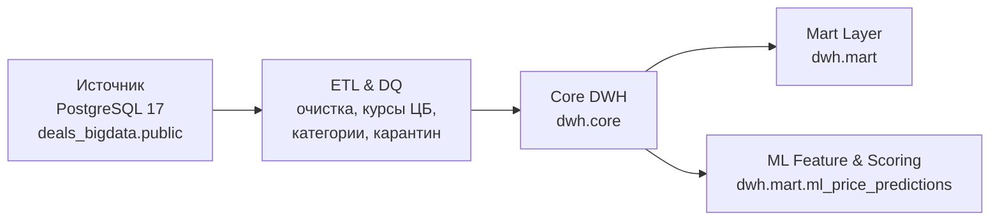
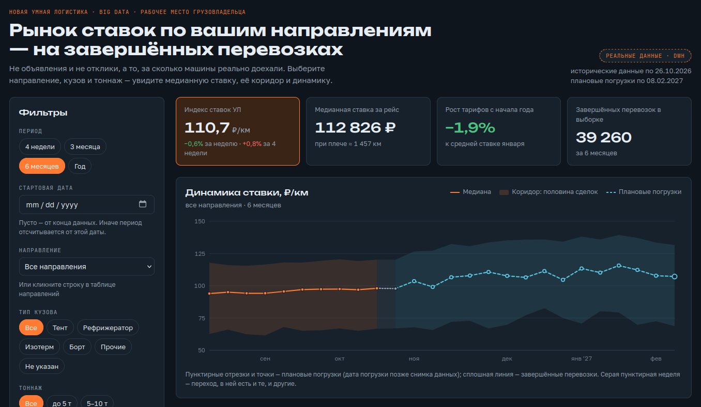
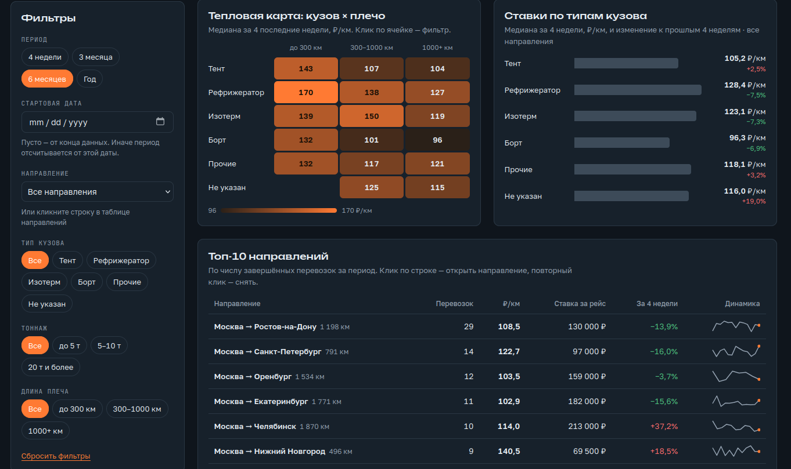
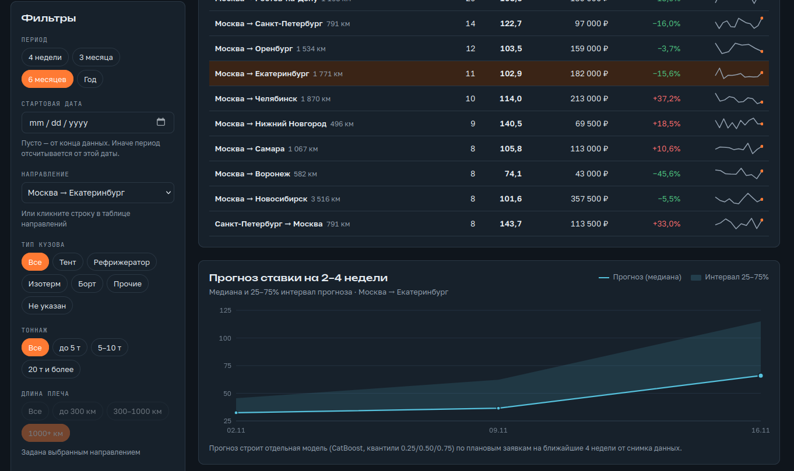
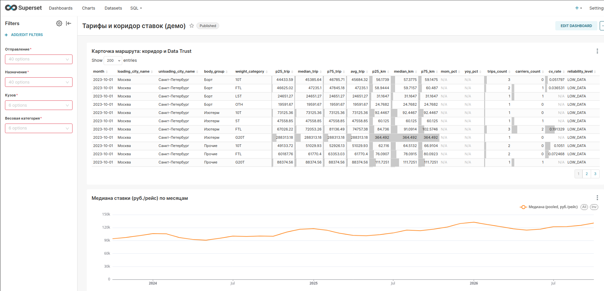
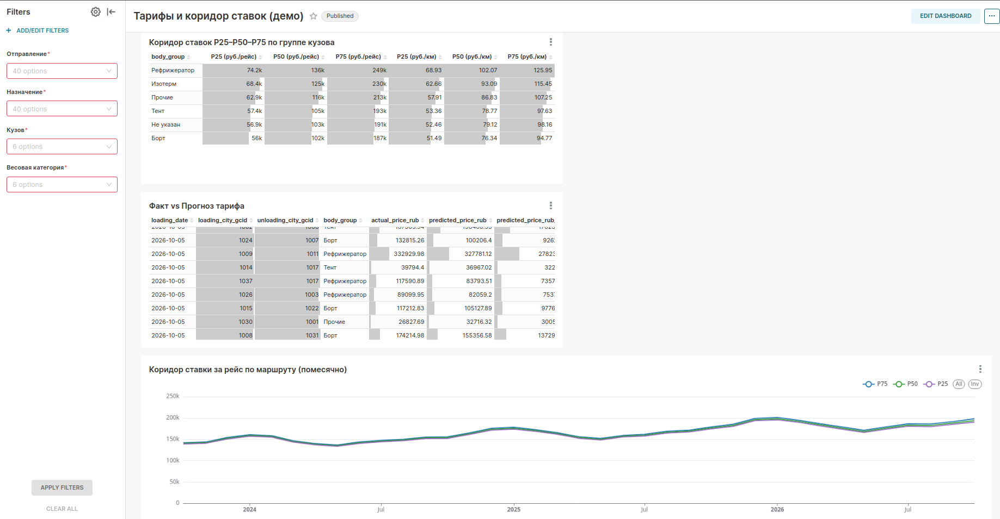
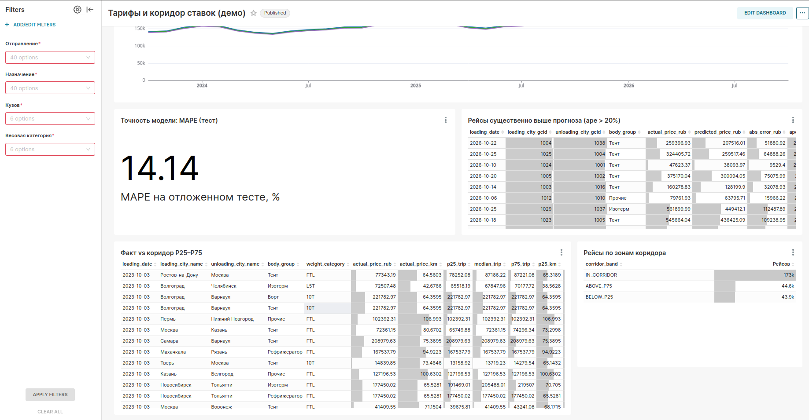

# Платформа аналитики и прогнозирования тарифов грузоперевозок
## Smart Logistics Data & ML Platform

> Take-home проект **Middle Data Engineer**. Сквозной прототип: операционный источник →
> Core DWH → аналитические витрины (Mart) → ML-прогноз тарифа.
>
> Полный текст задания и чек-лист сдачи — [`docs/assignment.md`](docs/assignment.md).
> Поэтапные ТЗ — в `specs/step_0*.md`.

## Статус этапов

- [x] **Этап 1 — каркас проекта и инфраструктура**
- [x] **Этап 2 — ETL и Data Quality**
- [x] **Этап 3 — DWH, моделирование и аналитические витрины**
- [x] **Этап 4 — ML Feature Engineering и Batch Inference**
- [x] **Этап 5 — автотесты и верификация**
- [x] **Этап 6 — документация и сдача**
- [x] **Бонусный шаг 1.1 (★)** — Apache Airflow / Apache Superset / ClickHouse
  (DAG `etl_dwh_ml` выполняет полный цикл `init_source → etl → rebuild_marts →
  ml_train_score`; витрины и прогнозы переливаются в ClickHouse на
  `ReplacingMergeTree`; демо-дашборд Superset поставляется экспортом
  `superset/dashboards/demo.zip` и импортируется автоматически) —
  см. [`specs/step_01_1_bonus_star_tasks.md`](specs/step_01_1_bonus_star_tasks.md)
- [x] **API демо-дашборда «Рынок ставок»** — сервис FastAPI (`api/`), отдаёт
  реальные агрегаты из `core.prices` в формате `bigdata-demo.html` (недельный
  ряд ставок, heatmap, бары, топ направлений) — см. раздел ниже

## Архитектура (кратко)



Выбраны **две базы данных** в одном инстансе PostgreSQL 17:

| База | Назначение | Схемы |
| :--- | :--- | :--- |
| `deals_bigdata` | операционный источник (не модифицируется) | `public` — `schema.sql` + `synthetic.sql` |
| `dwh` | хранилище | `raw` (резерв, опционально), `core`, `mart` |

Слои соответствуют заданию `raw → core → mart`: источник `deals_bigdata.public` выступает
raw-слоем; `dwh.raw` зарезервирован под staging-копию (опционально), `dwh.core` — очищенные
данные, `dwh.mart` — витрины и прогнозы.

### Обоснование выбранного стека

- **СУБД — PostgreSQL 17.** Одно реляционное хранилище покрывает весь конвейер
  `raw → core → mart`: ссылочная целостность и транзакции (`DELETE + INSERT`,
  `UPSERT … ON CONFLICT`) дают идемпотентный backfill, оконные функции и
  `percentile_cont(0.25/0.50/0.75) WITHIN GROUP` считают рыночный коридор ставок,
  а индексы по зерну витрин держат производительность на сотнях тысяч строк.
  PostgreSQL 17 — обязательное требование задания; ClickHouse подключается как
  аддитивный бонус для аналитического слоя (раздел «Бонусные сервисы»).
- **Оркестратор — Apache Airflow (бонус ★); обязательная часть — plain Python.**
  Обязательный пайплайн — детерминированные CLI (`python -m etl.main`,
  `python -m ml.main`), параметризованные окном дат и `as_of`: воспроизводим и
  тестируется без внешней инфраструктуры. Бонусный DAG `etl_dwh_ml` вызывает те же
  команды со стадиями `init_source → etl → rebuild_marts → ml_train_score`, поэтому
  ручной и оркестрированный прогоны дают одинаковые результаты.
- **ML-модель — `CatBoostRegressor`.** Градиентный бустинг на деревьях нативно
  обрабатывает категориальные признаки (регион отправления/назначения, группа кузова,
  весовая/объёмная категории) без ручного one-hot/встраивания, устойчив к табличным
  данным с пропусками и подтверждён референсным отчётом
  [`attachments/ml-report.md`](attachments/ml-report.md) как рекомендуемый выбор.
  Точечный прогноз обучается с настраиваемым лоссом (`ML_POINT_LOSS`): по умолчанию
  **`RMSE`** (бейзлайн отчёта §1), для целевой метрики MAPE рекомендуется **`log_rmse`**
  (RMSE по `ln(y)` + smearing), также доступен нативный `MAPE`. В каждом прогоне
  обучаются и сравниваются все три варианта. Интервал `lo/hi` — две квантильные
  модели q25/q75. Модель обучается с фиксированным `random_seed`
  (`ML_RANDOM_SEED`), детерминированными границами `train/test`, хронологическим
  `val` и без утечек; итоговые метрики — в разделе «Этап 4».

## Структура репозитория

```text
.
├── docker-compose.yml          # PostgreSQL 17 + сервисы etl/ml/api (одной командой)
├── Dockerfile.etl              # образ ETL (Python 3.11, pandas/SQLAlchemy/psycopg)
├── Dockerfile.ml               # образ ML (+ scikit-learn, CatBoost)
├── Dockerfile.api              # образ API демо-дашборда (FastAPI)
├── requirements.txt            # пины зависимостей ETL
├── requirements-ml.txt         # пины зависимостей ML
├── requirements-api.txt        # пины зависимостей API (fastapi/uvicorn)
├── .env.example                # шаблон конфигурации (переменные окружения)
├── docker/
│   ├── postgres/init/          # инициализация БД (bootstrap dwh + источник)
│   └── airflow/                # образ Airflow + зависимости проекта (★)
├── sql/
│   ├── schema.sql              # эталонная DDL источника (без изменений)
│   ├── synthetic.sql           # детерминированный генератор (setseed 0.20261026)
│   ├── dwh/                    # DDL Core/Mart (этапы 2–3)
│   └── clickhouse/             # DDL ClickHouse MergeTree/ReplacingMergeTree (★)
├── common/                     # общий код: конфигурация и логирование
├── etl/                        # пайплайн ETL (этап 2)
├── ml/                         # ML-пайплайн (этап 4)
├── api/                        # API демо-дашборда «Рынок ставок» (FastAPI)
├── web/                        # дашборд bigdata-demo.html, подключённый к API
├── clickhouse/                 # переливка витрин PostgreSQL → ClickHouse (★)
├── superset/                   # bootstrap и экспорт дашбордов Superset (★)
├── tests/                      # pytest + SQL smoke (этап 5)
├── dags/                       # Apache Airflow DAG etl_dwh_ml (★)
└── docs/assignment.md          # исходный текст задания
```

## Быстрый старт

```bash
# 1. (опционально) сконфигурировать порты/пароли
cp .env.example .env

# 2. поднять PostgreSQL 17 и инициализировать источник
docker compose up -d

# 3. проверить состояние
docker compose ps

# 4. проверить источник (должно быть 300000)
docker compose exec postgres psql -U postgres -d deals_bigdata \
  -c 'SELECT count(*) AS prices FROM prices;'

# 5. проверить схемы хранилища
docker compose exec postgres psql -U postgres -d dwh \
  -c '\dn'
```

Полный сброс (переинициализация источника):

```bash
docker compose down -v && docker compose up -d
```

## API демо-дашборда «Рынок ставок»

Отдельный сервис (FastAPI, один контейнер) отдаёт **реальные** агрегаты из DWH
в формате самодостаточной страницы `bigdata-demo.html`. Данные — из
[`core.prices`](sql/dwh/00_core_schema.sql) с недельным зерном
(`date_trunc('week', loading_date)`), фильтры выборки совпадают с
[`mart_route_card`](sql/dwh/02_mart_route_card.sql).

Стартует вместе с `docker compose up -d`; порт — `API_HOST_PORT` (по умолчанию
`8000`). Требует загруженного хранилища (этапы 2–3: `core.prices` + справочники).

Сам дашборд (переработанный `bigdata-demo.html`) сервис раздаёт статикой из
[`web/index.html`](web/index.html) — он подключён к этим эндпоинтам и открывается
на корневом пути:

```bash
docker compose up -d api        # отдельно (при уже поднятом postgres)

open http://localhost:8000/      # дашборд «Рынок ставок» (реальные данные)
open http://localhost:8000/docs  # Swagger UI
curl http://localhost:8000/health
```

Скриншоты веб-интерфейса дашборда «Рынок ставок» (`web/index.html`):





> `postgres` в `docker-compose.yml` поднимается с `shm_size: 512m` — параллельные
> агрегаты `percentile_cont` упираются в дефолтные 64 МБ `/dev/shm` Docker
> («could not resize shared memory segment»).

Эндпоинты (все возвращают JSON; `all` = срез не применён):

| Метод/путь | Назначение |
|---|---|
| `GET /health` | живость + доступность DWH |
| `GET /api/dims` | направления (топ по сделкам), кузова, тоннаж, плечи |
| `GET /api/series?dir=&body=&ton=&leg=&period=` | недельный ряд ставок (`med/lo/hi` ₽/км, `n`) + KPI |
| `GET /api/heat?dir=&ton=` | heatmap «кузов × плечо» за 4 недели и Δ |
| `GET /api/bars?dir=&ton=&leg=` | ставка по кузовам за 4 недели и Δ |
| `GET /api/top?body=&ton=&leg=&limit=` | топ направлений + спарклайн за 13 недель |

Срезы: `dir` = `"<gcid>:<gcid>"`, `body`/`ton`/`leg` — ключи из `/api/dims`.
Маппинг на DWH: `ton` ← `weight_category` (5T/L5T/OTH→«5», 10T→«10»,
FTL/G20T→«20»), `leg` ← `distance`; срез `cargo` в данных отсутствует и не
отдаётся (см. [`api/queries.py`](api/queries.py)).

## Конфигурация (переменные окружения)

Все параметры — в `.env` (шаблон [`.env.example`](.env.example)). В коде нет
захардкоженных паролей и абсолютных путей.

| Переменная | Дефолт | Назначение |
| :--- | :--- | :--- |
| `POSTGRES_USER` / `POSTGRES_PASSWORD` | `postgres` / `postgres` | суперпользователь (dev-дефолт) |
| `POSTGRES_DB` | `deals_bigdata` | операционная БД-источник |
| `POSTGRES_HOST_PORT` | `5432` | порт хоста → `5432` контейнера |
| `DWH_DB` | `dwh` | БД хранилища |
| `DWH_USER` / `DWH_PASSWORD` | `dwh_user` / `dwh_password` | прикладная роль ETL/ML |
| `N_PRICES` | `300000` | объём генерируемого источника |
| `RANDOM_SEED` | `0.20261026` | зерно генератора (справочно) |
| `AS_OF` | `2026-10-26` | дата снимка данных |
| `ML_RANDOM_SEED` | `42` | зерно воспроизводимости ML |
| `LOG_LEVEL` | `INFO` | уровень логирования |

## Проектные решения этапа 1

1. **Две БД, один инстанс.** Источник `deals_bigdata` отделён от хранилища `dwh`
   (схемы `raw`/`core`/`mart`), чтобы не смешивать source и DWH. Источник не модифицируется.
2. **Раздельные образы** `Dockerfile.etl` и `Dockerfile.ml` — ML-образ тяжелее
   (CatBoost), ETL остаётся лёгким.
3. **Эталонные SQL сохранены как есть** (`sql/schema.sql`, `sql/synthetic.sql`);
   DDL хранилища ляжет в `sql/dwh/`.
4. **Детерминированность источника** — генератор использует фиксированное зерно
   `setseed(0.20261026)` (зашито в `sql/synthetic.sql`, не переопределяется).
5. **Идемпотентный init** — инициализация источника пропускается, если `prices` уже
   наполнена; данные хранятся в named volume, повторный `up` их не дублирует.

## Этап 2 — ETL и Data Quality (запуск)

Пайплайн читает источник батчами, валидирует и очищает строки, конвертирует валюту
в RUB, заполняет категории груза и идемпотентно пишет результат в `dwh.core`.
Отбракованные строки не теряются и попадают в карантин `core.dq_quarantine_prices`.

### Запуск

```bash
# профиль etl (образ ulog-etl:latest)
docker compose --profile etl build etl

# backfill всего доступного периода источника
docker compose --profile etl run --rm etl \
  python -m etl.main --start-date 2023-01-01 --end-date 2027-12-31

# либо один день (именно так вызывает DAG Airflow: --start-date "{{ ds }}" --end-date "{{ ds }}")
docker compose --profile etl run --rm etl \
  python -m etl.main --start-date 2026-10-26 --end-date 2026-10-26
```

Повторный прогон за тот же период **строго идемпотентен**: `core.prices` обновляется
по ключу `price_id` (`INSERT ... ON CONFLICT DO UPDATE`), карантин перезаписывается
для окна `loading_date` (`DELETE` + `INSERT` в одной транзакции). Количество строк,
контрольные суммы и перцентили не задваиваются.

### Проверка результата

```bash
docker compose exec postgres psql -U postgres -d dwh -c \
  'SELECT count(*) AS prices, round(sum(price_rub)::numeric, 2) AS sum_rub FROM core.prices;'

docker compose exec postgres psql -U postgres -d dwh -c \
  'SELECT reason_code, count(*) FROM core.dq_quarantine_prices GROUP BY 1 ORDER BY 1;'
```

### Правила Data Quality и карантин

| reason_code | Условие |
| :--- | :--- |
| `INVALID_PRICE` | `price <= 0` (или `NULL`) |
| `PRICE_BELOW_SOURCE_RANGE` | `currency_code = '643'` и `0 < price <= 1000` |
| `INVALID_DISTANCE` | `distance <= 0` |
| `INVALID_WEIGHT` | `total_weight < 0` |
| `INVALID_VOLUME` | `total_volume < 0` |
| `MISSING_CITY` | `loading/unloading_city_gcid` отсутствует в `cities` |
| `MISSING_RATE` | валюта `840`/`978` без точного курса по `nearest_rate_date` |

Карантин хранит **одну строку на `(price_id, reason_code)`**, поэтому статистика
отсева считается по каждой причине без дублей. `PRICE_BELOW_SOURCE_RANGE` не
пересекается с `INVALID_PRICE` (нулевые/отрицательные цены покрывает последний).

### Конвертация валют (единая валюта RUB без НДС)

* `643` (RUB) — курс `1.0`, `price_rub = price`.
* `840` (USD) / `978` (EUR) — **точный курс** по `nearest_rate_date`
  (`exchange_rates.setting_date = nearest_rate_date`); `price_rub = price * rate`.
* Если точного курса нет (в т.ч. `nearest_rate_date IS NULL`), строка уходит в
  карантин `MISSING_RATE`; **fallback по `loading_date` не используется**.
* Для полноты: в production `nearest_rate_date` заполняется относительно `created_at`
  (последний `setting_date <= created_at`, а при отсутствии курса — последующий;
  детерминированный выбор редкой будущей ветки — `MIN(setting_date) > created_at`).
  ETL не пересчитывает это поле, а использует его как есть.

### Категории груза

`weight_category` (по `total_weight`, округление до 0.1 т): `G20T` ≥ 30 т,
`FTL` [10; 30), `10T` [5; 10), `5T` [2.5; 5), `L5T` [0.5; 2.5), иначе `OTH`.
`volume_category`: `FTL` при `0 < total_volume <= 120`, иначе `OTH`.
Пропуски заполняются, уже заполненные значения не перезаписываются.

### Автотесты правил DQ

Юнит-тесты правил очистки/категорий/валют — в [`tests/test_dq.py`](tests/test_dq.py):

```bash
python -m pytest tests/ -q          # локально (pip install -r requirements-dev.txt)
```

### Ограничение исходных данных (зафиксировано)

Самые свежие сделки за день снимка `2026-10-26` ещё не прошли ночной job разметки
аномалий и имеют `outlier_mark = false` по умолчанию — это ограничение источника.
Флаг `outlier_mark` в ETL **не пересчитывается** (используется как входной), а
фильтрация выбросов выполняется на этапе 3 при расчёте витрин.

## Этап 3 — Mart Layer (запуск)

Поверх очищенного `core` строится слой `mart` с двумя витринами:
[`mart.mart_route_card`](sql/dwh/01_mart_schema.sql) — «Карточка маршрута и коридор
рыночных ставок» (эталонный расчёт — [`sql/dwh/02_mart_route_card.sql`](sql/dwh/02_mart_route_card.sql))
и [`mart.fact_vs_corridor`](sql/dwh/01_mart_schema.sql) — «Факт × рыночный коридор»
(эталонный расчёт — [`sql/dwh/03_fact_vs_corridor.sql`](sql/dwh/03_fact_vs_corridor.sql));
пересчёт обеих — [`etl/marts.py`](etl/marts.py).

### Пересчёт витрин

```bash
# пересчитать витрины mart (атомарная перезапись, идемпотентно)
docker compose --profile etl run --rm etl \
  python -m etl.main --rebuild-marts --as-of 2026-10-26
```

Команда применяет DDL `core`/`mart`, обновляет справочники и копирует
`public.price_body_types` / `public.price_dates` в `core` (чтобы весь расчёт шёл в
одной БД `dwh` чистым SQL), затем **атомарно** перезаписывает витрину
(`DELETE + INSERT` в одной транзакции). Повторный прогон даёт идентичные строки,
контрольные суммы и перцентили; `PRIMARY KEY` по зерну страхует от дублей.

### Зерно и правила расчёта

- **Зерно:** `месяц × город отправления × город назначения × группа кузова × весовая категория`.
  Месяц строится из `price_dates.price_date` (долгосрочная заявка попадает в несколько
  месяцев); `volume_category` сохранён как атрибут (мода ячейки) и в grain не входит.
- **Города:** дедуплицированный `core.cities` (одна строка на `gc_id`, минимальный
  `cities.id`) — дубли `gc_id` не размножают сделки.
- **Группа кузова:** `price_body_types` (по `std_id` родителя) → fallback
  `prices.body_type` → «Не указан». Одна цена даёт одну строку на группу.
- **Фильтры выборки:** `price_type IN (1,2,3,4,5,9)`, `complex = false`, `price > 0`,
  `distance > 0`, корректный `price_rub`, `outlier_mark = false`, и исключены
  плановые месяцы будущего (`price_date > '2026-10-26'`).
- **Метрики (RUB без НДС):** коридор `p25/p50/p75` и `avg` за рейс и за км;
  `trips_count`, `carriers_count` (только `price_type IN (3,9)`), `cv_rate`,
  `mom_pct` / `yoy_pct` (без подстановки «последнего доступного» месяца) и
  `reliability_level` (`HIGH`/`MEDIUM`/`LOW_DATA` с учётом свежести относительно `as_of`).

### Проверка витрины (SQL)

```bash
docker compose exec postgres psql -U postgres -d dwh \
  -c 'SELECT count(*) FROM mart.mart_route_card;'
```

```sql
-- карточка маршрута: коридор ставок и доказательная база
SELECT month, loading_city_name, unloading_city_name, body_group, weight_category,
       p25_trip, median_trip, p75_trip, avg_trip,
       p25_km, median_km, p75_km,
       trips_count, carriers_count, cv_rate, mom_pct, yoy_pct, reliability_level
FROM mart.mart_route_card
WHERE loading_city_gcid = 1001 AND unloading_city_gcid = 1008
  AND body_group = 'Тент' AND weight_category = 'FTL'
ORDER BY month DESC;

-- консистентность коридора и отсутствие дублей города/кузова
SELECT count(*) FILTER (WHERE NOT (p25_trip <= median_trip AND median_trip <= p75_trip)) AS trip_viol,
       count(*) FILTER (WHERE NOT (p25_km   <= median_km   AND median_km   <= p75_km))   AS km_viol
FROM mart.mart_route_card;
```

Эталонный SQL можно прогнать вручную и без записи в таблицу:
`psql -U dwh_user -d dwh -f sql/dwh/02_mart_route_card.sql`.

### Витрина «Факт × коридор» (`mart.fact_vs_corridor`)

Для пост-анализа «насколько фактическая цена закрытой сделки отклонилась от рынка»
каждая фактическая сделка сопоставляется с коридором `P25–P50–P75` своей ячейки
(месяц погрузки × маршрут × кузов × вес) из `mart_route_card`. Зерно —
`(price_id, body_group)` (цена с несколькими кузовами даёт строку на каждую группу).

```sql
-- отклонение факта от коридора и зона сделки
SELECT loading_date, loading_city_name, unloading_city_name, body_group,
       actual_price_rub, p25_trip, median_trip, p75_trip,
       trip_vs_median_pct, km_vs_median_pct, corridor_band, reliability_level
FROM mart.fact_vs_corridor
ORDER BY loading_date DESC
LIMIT 20;

-- распределение сделок по зонам коридора
SELECT corridor_band, count(*) FROM mart.fact_vs_corridor GROUP BY 1 ORDER BY 1;
```

## Этап 4 — ML Feature Engineering & Batch Inference (запуск)

Поверх очищенного `core` строится воспроизводимый ML-пайплайн прогнозирования
фактической ставки перевозчика за рейс в рублях без НДС (`target = price_rub`):
признаки **без утечек**, хронологическое разбиение `train`/`test`, отсечение
выбросов таргета по IQR логарифма (границы — **строго по `train`**), хронологический
`val`-хвост под раннюю остановку, обучение **точечных `CatBoostRegressor`** со всеми
поддерживаемыми лоссами (`RMSE` — по умолчанию, `log_rmse` — рекомендован для MAPE,
`MAPE` — нативный) для честного сравнения и двух квантильных моделей q25/q75 для
интервала, а также референсные бейзлайны `Ridge`/`DecisionTree` (отчёт §5). Пакетный
скоринг пишет прогнозы в [`mart.ml_price_predictions`](sql/dwh/01_mart_schema.sql)
(«Факт vs Прогноз»): точечный прогноз `predicted_price_rub` (основной лосс) и честный
интервал `predicted_price_rub_lo`/`predicted_price_rub_hi` (q25/q75). Помимо
глобальных `R²`/`MAPE`/`RMSE`/`MAE` считаются покрытие интервала (PICP) и метрики
`MAPE`/`MAE` в разрезе направлений (`origin_region → destination_region`).

Код: [`ml/features.py`](ml/features.py) (инженерия признаков и защита от утечек),
[`ml/data.py`](ml/data.py) (чтение `core`), [`ml/pipeline.py`](ml/pipeline.py)
(обучение/оценка/скоринг), [`ml/main.py`](ml/main.py) (CLI).

### Запуск

```bash
# полный цикл: обучение + оценка + batch-скоринг (as_of из окружения AS_OF)
docker compose --profile ml build ml
docker compose --profile ml run --rm ml python -m ml.main --as-of 2026-10-26

# повторный скоринг без переобучения (загружает сохранённую модель)
docker compose --profile ml run --rm ml python -m ml.main --as-of 2026-10-26 --skip-train

# подбор гиперпараметров: CLI переопределяет env, прогон воспроизводим
docker compose --profile ml run --rm ml python -m ml.main --as-of 2026-10-26 \
  --point-loss MAPE --depth 8 --l2-leaf-reg 5.0 --learning-rate 0.05
```

Повторный запуск **идемпотентен**: прогнозы пишутся `UPSERT` по ключу
`(price_id, model_name)`, поэтому число строк не задваивается. Обученные модели
(четыре файла `catboost_point.cbm` / `catboost_point_<loss>.cbm` / `catboost_q25.cbm`
/ `catboost_q75.cbm`) сохраняются в named volume `ml_artifacts` (путь —
`ML_MODEL_PATH`), что делает работоспособным `--skip-train` между запусками.
`--skip-train` должен запускаться с тем же `--point-loss`/`ML_POINT_LOSS`, что и
обучение, чтобы артефакт `catboost_point.cbm` соответствовал выбранному основному
лоссу.

### Гиперпараметры и сравнение точечных лоссов

Точечная модель обучается с основным лоссом (`ML_POINT_LOSS`, по умолчанию `RMSE`)
и **параллельно** со всеми остальными поддерживаемыми лоссами (`log_rmse`, `MAPE`),
чтобы каждый прогон логировал честное сравнение вариантов на `test` без повторного
чтения данных. Основной вариант пишется в `mart.ml_price_predictions`; остальные —
только для сравнения метрик.

| Лосс | Описание |
| :--- | :--- |
| `RMSE` | Бейзлайн отчёта §1; оптимизирует абсолютную ошибку. |
| `log_rmse` | RMSE по `ln(y)` + smearing-поправка: симметричная оптимизация относительной ошибки, **рекомендуется для целевой метрики MAPE**. |
| `MAPE` | Нативный лосс CatBoost; на логнормальных тарифах склонен к сильному занижению (bias ≪ 0), обычно не рекомендуется. |

Параметр задаётся env-переменной или флагом CLI (CLI приоритетнее env):

| Назначение | Env | CLI | Дефолт |
| :--- | :--- | :--- | :---: |
| Основной лосс точечной модели | `ML_POINT_LOSS` | `--point-loss` | `RMSE` |
| Глубина деревьев | `ML_DEPTH` | `--depth` | `6` (дефолт CatBoost) |
| L2-регуляризация листьев | `ML_L2_LEAF_REG` | `--l2-leaf-reg` | `3.0` |
| Скорость обучения | `ML_LEARNING_RATE` | `--learning-rate` | `0.03` |

В лог попадают записи `ml.metrics` для каждого варианта (`role=primary`/`role=compare`)
и сводная строка `ml.compare` с `delta_mape_pct = MAPE(лучший из остальных) - MAPE(primary)`
(положительное значение означает, что основной вариант лучше). Итоговый `ml.done`
также содержит поле `point_metrics` — словарь `{loss: {r2, mape_pct, rmse, mae,
bias_pct}}` для всех вариантов. Воспроизводимость обеспечивают фиксированные
`ML_RANDOM_SEED`, детерминированные границы `train/test` и лог всех эффективных
гиперпараметров (`depth`, `l2_leaf_reg`, `learning_rate`).

### Grid-search тюнинг (`ml.tune`)

Для автоматического подбора оптимальных параметров используется read-only скрипт
[`ml/tune.py`](ml/tune.py) (`python -m ml.tune`): он перебирает сетку
`loss × depth × l2_leaf_reg × learning_rate`, для каждой ячейки обучает точечную
модель с хронологическим `val` (ранняя остановка) и оценивает метрики на `test`,
**не записывая прогнозы в БД**. По итогу печатает отсортированную таблицу и блок
«РЕКОМЕНДОВАННЫЕ ПАРАМЕТРЫ» (лучшая ячейка по целевой метрике, по умолчанию MAPE).

```bash
docker compose --profile ml run --rm ml python -m ml.tune --as-of 2026-10-26

# уже целевая сетка + сохранение полной таблицы в CSV
docker compose --profile ml run --rm ml python -m ml.tune --as-of 2026-10-26 \
  --metric mape_pct --losses RMSE,log_rmse --depth 6,8 \
  --l2-leaf-reg 3.0,5.0 --learning-rate 0.03,0.1 \
  --out /app/ml/artifacts/tune_results.csv
```

Доступные лоссы в сетке: `RMSE` (бейзлайн), `MAPE` (нативный CatBoost) и `log_rmse`
(RMSE по `ln(y)` + smearing-поправка — симметричная оптимизация относительной
ошибки без патологического смещения MAPE-лосса). На логнормальных тарифах
`log_rmse`/`RMSE` обычно дают заметно меньший MAPE, чем нативный `MAPE`-лосс,
поэтому их рекомендуется держать в сетке. Полученные рекомендованные параметры
переносятся в `ml.main` (флаги `--point-loss`/`--depth`/`--l2-leaf-reg`/
`--learning-rate` или env `ML_*`) для финального batch-скоринга.

### Признаки и защита от утечек (Data Leakage)

| Группа | Признаки |
| :--- | :--- |
| География и маршрут | `origin_region` / `destination_region` (из `full_name_local`), `origin_city` / `destination_city`, координаты `origin_lat/lon` / `dest_lat/lon` — отправление и назначение кодируются **раздельно** |
| Груз и транспорт | `distance`, `total_weight`, `total_volume`, `body_group` (унифицированная группа кузова), `weight_category`, `volume_category` |
| Циклические даты | `year` (тренд) + `month_sin/cos` (T=12), `dow_sin/cos` (T=7), `doy_sin/cos` (T=365.25) от `loading_date` |

Из признакового пространства **исключены** любые производные таргета: `price`/
`price_rub`, `price_with_vat`, удельные тарифы (`price/distance`, `price/weight`),
`rate_value`, `price_group_id` и агрегаты `price_group_stats`. `outlier_mark`
используется только для очистки таргета (обучение/тест без выбросов) и **не**
входит в признаки. Состав матрицы фиксирован в
[`ml/features.py`](ml/features.py) (`FEATURE_COLUMNS`) и проверяется
`assert_no_leakage` (+ юнит-тесты).

### Временное разбиение (Time-Based Split)

Только фактические прямые сделки (`is_fact = true`, `complex = false`),
разбиение **строго по `loading_date`** относительно даты снимка `as_of = 2026-10-26`
(не системной даты запуска), без перемешивания:

- `train`: `[2026-07-26, 2026-10-05)` — левая граница включительно;
- `test`: `[2026-10-05, 2026-10-26]` — обе границы включительно;
- `future` (скоринг): `loading_date > 2026-10-26` (читается отдельным запросом
  `load_future_frame`, без требования `is_fact`/`price_rub`).

Граница `2026-10-05` входит только в `test`. Из хвоста `train` дополнительно
выделяется **хронологический `val`** (последние 20% по дате, без перемешивания)
для ранней остановки CatBoost — будущее относительно `val` в обучение не попадает.

### Метрики (на `test`, RUB без НДС)

Точечный прогноз даёт модель с основным лоссом (по умолчанию `RMSE`, для MAPE
рекомендуется `log_rmse`); интервал `lo/hi` — квантили q25/q75. Помимо глобальных
метрик логируются знаковое смещение `bias_pct` (диагностика асимметрии MAPE),
`PICP` (покрытие интервала) и таблица `MAPE`/`MAE`/`R²` по направлениям, а также
бейзлайны `Ridge`/`DecisionTree`.

| Метрика | Значение (ориентир прошлого прогона) |
| :--- | :--- |
| **R²** | **0.917** |
| **MAPE** | **16.06%** |
| **RMSE** | **55 091.96 руб.** |
| **MAE** | **28 526.93 руб.** |

> Ориентир из [`attachments/ml-report.md`](attachments/ml-report.md) — CatBoost
> ~0.93 R² / ~13% MAPE; точные значения на синтетическом датасете зависят от окна
> `train/test` и набора признаков (там это «качественный ориентир, не цель»).
> `random_seed = ML_RANDOM_SEED` (42) и границы разбиения фиксированы — результат
> воспроизводим. Приведённые числа — ориентир прошлого прогона; при выборе
> `log_rmse` MAPE обычно ниже, а RMSE/MAE могут незначительно измениться — это
> ожидаемый компромисс между относительной и абсолютной точностью. Нативный
> `MAPE`-лосс на этих данных даёт худший результат (сильное занижение, bias ≪ 0).

### Проверка прогнозов (SQL)

```bash
docker compose exec postgres psql -U postgres -d dwh \
  -c 'SELECT count(*) FROM mart.ml_price_predictions;'
```

```sql
-- факт vs прогноз за тестовый период (точка RMSE + интервал q25/q75)
SELECT loading_date, loading_city_gcid, unloading_city_gcid, body_group,
       round(actual_price_rub::numeric, 2)        AS actual_rub,
       round(predicted_price_rub_lo::numeric, 2)  AS predicted_lo_rub,
       round(predicted_price_rub::numeric, 2)     AS predicted_rub,
       round(predicted_price_rub_hi::numeric, 2)  AS predicted_hi_rub,
       round(abs_error_rub::numeric, 2)           AS abs_error_rub,
       round(ape_pct::numeric, 2)                 AS ape_pct
FROM mart.ml_price_predictions
WHERE loading_date <= '2026-10-26'
ORDER BY loading_date DESC, price_id
LIMIT 20;

-- честный интервал: везде lo <= med <= hi
SELECT count(*) FILTER (WHERE NOT (predicted_price_rub_lo <= predicted_price_rub
                                AND predicted_price_rub <= predicted_price_rub_hi)) AS bad_order
FROM mart.ml_price_predictions;

-- будущие заявки: факт и ошибки обязаны быть NULL (даже если в источнике есть price)
SELECT count(*) FILTER (WHERE actual_price_rub IS NOT NULL) AS bad_fact_not_null,
       count(*) FILTER (WHERE abs_error_rub  IS NOT NULL)  AS bad_abs_not_null,
       count(*) FILTER (WHERE ape_pct        IS NOT NULL)  AS bad_ape_not_null,
       count(*)                                             AS future_total
FROM mart.ml_price_predictions
WHERE loading_date > '2026-10-26';
```

### Автотесты признаков и разбиения

Юнит-тесты ML-логики (регионы, группы кузова, циклические признаки, отсутствие
утечек, границы `train/test`) — в [`tests/test_ml_features.py`](tests/test_ml_features.py):

```bash
python -m pytest tests/ -q          # локально (pip install -r requirements-dev.txt)
```

## Этап 5 — автотесты и верификация (запуск)

Автотесты делятся на две группы — юнит-тесты (без БД) и интеграционные
(маркер `db`, требуют поднятый PostgreSQL; при недоступной БД автоматически
пропускаются):

| Файл | Тип | БД | Что проверяет |
| :--- | :--- | :---: | :--- |
| [`tests/test_dq.py`](tests/test_dq.py) | юнит | — | правила DQ: карантин, конвертация валют, категории на границах |
| [`tests/test_marts.py`](tests/test_marts.py) | юнит | — | вспомогательная логика пересчёта витрин |
| [`tests/test_ml_features.py`](tests/test_ml_features.py) | юнит | — | регионы, кузова, циклические даты, запрещённые признаки, границы разбиения |
| [`tests/test_ml_split.py`](tests/test_ml_split.py) | юнит | — | непересечение `train/test/future`, построчная инженерия признаков |
| [`tests/test_idempotency.py`](tests/test_idempotency.py) | `db` | да | двойной прогон ETL/витрин/ML-скоринга без дублей |
| [`tests/test_sql_smoke.py`](tests/test_sql_smoke.py) | `db` | да | консистентность витрины, дедупликация городов, унификация кузовов, NULL-факт будущих прогнозов |

Маркеры объявлены в [`pytest.ini`](pytest.ini); параметры подключения к БД —
из переменных окружения (`.env.example`).

### Запуск юнит-тестов (без БД)

```bash
pip install -r requirements-dev.txt
python -m pytest tests/ -q
```

### Запуск всех тестов (включая интеграционные, нужна БД)

```bash
# 1. поднять PostgreSQL 17 + источник
docker compose up -d

# 2. собрать образ с зависимостями ML (pandas/SQLAlchemy/psycopg/scikit-learn/CatBoost)
docker compose --profile ml build ml

# 3. прогнать весь набор тестов в контейнере (сеть compose резолвит `postgres`)
docker compose --profile ml run --rm -v "$PWD:/app" --entrypoint bash ml \
  -c "pip install -q pytest==8.3.3 && python -m pytest tests/ -q"
```

> Локальный прогон интеграционных тестов вне Docker требует, чтобы `DB_HOST`/
> `DB_PORT` указывали на опубликованный порт контейнера (`POSTGRES_HOST_PORT`
> из `.env`); иначе тесты с маркером `db` будут пропущены как «БД недоступна».

### Что покрывают тесты

- **DQ (юнит):** `price <= 0`, `price <= 1000` для RUB, `distance/weight/volume`,
  отсутствие города в `cities`, валюта `840/978` без точного курса → карантин;
  конвертация по точному курсу (`643` → курс `1.0`); границы категорий
  (`10.0`, `30.0`, `0`, `120`) и заполнение пропусков.
- **Идемпотентность (`db`):** двойной прогон ETL за окно `2026-09-01…30`, двойной
  пересчёт `mart` и повторный скоринг ML не задваивают строки и не меняют суммы и
  перцентили.
- **SQL smoke (`db`):** `mart_route_card` непуст и согласован (`P25 <= P50 <= P75`,
  `trips_count >= 0`); дубли `cities.gc_id` не размножают сделки; одна цена не
  дублируется внутри группы кузова; у будущих прогнозов факт/ошибки — `NULL`.
- **ML-утечки (юнит):** запрещённые колонки отсутствуют в матрице признаков,
  `outlier_mark` не является признаком, разбиение строго по `loading_date` без
  перемешивания, циклические признаки в диапазоне `[-1; 1]`, инженерия признаков
  построчная (без подгонки статистик на `train`).

## Зафиксированные ограничения данных

Сводка осознанных ограничений источника и принятых решений (по чек-листу сдачи):

1. **Свежие сделки за день снимка `2026-10-26`** ещё не прошли ночной job разметки
   аномалий и имеют `outlier_mark = false` по умолчанию — это ограничение источника,
   а не ошибка ETL. Флаг в пайплайне не пересчитывается (используется как входной);
   фильтрация выбросов выполняется только при расчёте витрин (этап 3).
2. **Конвертация валют и `nearest_rate_date`.** `643` (RUB) → курс `1.0`;
   `840` (USD) / `978` (EUR) → точный курс по `nearest_rate_date`
   (`exchange_rates.setting_date = nearest_rate_date`). При отсутствии точного курса
   (в т.ч. `nearest_rate_date IS NULL`) строка уходит в карантин `MISSING_RATE`;
   fallback по `loading_date` не используется. В production `nearest_rate_date`
   заполняется относительно `created_at` (а не `loading_date`); ETL использует поле
   как есть и не пересчитывает его.
3. **Совпадение `loading_city_gcid = unloading_city_gcid` не является DQ-правилом.**
   Исходный job сохраняет такую пару вместе с расстоянием, поэтому в обязательном
   решении она не отбраковывается. Отбросить такие строки можно только как отдельную
   документированную бизнес-гипотезу — в данной реализации эта гипотеза не применяется.
4. **Пересчёт выбросов на уровне ETL/витрин не реализован.** Дополнительный пересчёт
   по аналогии с `MarkOutlierPrices` (только факты, группа `price_group_id` с минимум
   4 строками, IQR по сырому `price`, P5–P95 по сырому `price_km`) для `mart`-слоя
   допустим как необязательное улучшение. При этом **ML-пайплайн** дополнительно
   отсекает выбросы таргета сам — по IQR логарифма `price_rub`, с границами,
   рассчитанными строго по `train`-выборке (отчёт §2.2); входной флаг `outlier_mark`
   остаётся как pre-filter источника.

## Бонусные сервисы (★)

Бонусы аддитивны: обычный `docker compose up -d` по-прежнему поднимает только
PostgreSQL 17 + источник. Каждый бонус включается отдельным профилем и использует
те же результаты обязательной части.

### Apache Airflow

```bash
docker compose --profile airflow up -d
```

- UI: http://localhost:8080 (логин — `AIRFLOW_ADMIN_USER` / `AIRFLOW_ADMIN_PASSWORD`).
- DAG [`dags/etl_dwh_ml.py`](dags/etl_dwh_ml.py) выполняет полный цикл
  `init_source → etl → rebuild_marts → ml_train_score`.
- `init_source` идемпотентно переиспользует [`docker/postgres/init`](docker/postgres/init);
  `etl`/`rebuild_marts`/`ml_train_score` вызывают те же команды, что и ручной прогон
  (`python -m etl.main` / `python -m ml.main`), поэтому результаты совпадают.
- Окно дат берётся из `logical_date` (`{{ ds }}`) или переопределяется при триггере:
  ```bash
  docker compose --profile airflow exec airflow-scheduler \
    airflow dags trigger etl_dwh_ml \
    --conf '{"start_date": "2026-01-01", "end_date": "2026-10-26"}'
  ```
- Повторный прогон за тот же интервал идемпотентен (UPSERT / DELETE+INSERT в самих стадиях).

### Apache Superset

```bash
docker compose --profile superset up -d
```

- UI: http://localhost:8088 (логин — `SUPERSET_ADMIN_USER` / `SUPERSET_ADMIN_PASSWORD`).
- Bootstrap и запуск: [`superset/superset-init.sh`](superset/superset-init.sh).
- Демо-дашборд **«Тарифы и коридор ставок (демо)»** поставляется готовым экспортом
  [`superset/dashboards/demo.zip`](superset/dashboards/demo.zip) и импортируется
  автоматически при старте: карточка маршрута (коридор P25–P50–P75 за рейс и за км,
  Data Trust), пульная медиана по месяцам и пульный коридор по группе кузова
  (по `mart.v_route_card_facts`, а не `AVG(median_trip)`) и «Факт vs Прогноз» с
  доверительным интервалом (`predicted_price_rub_lo`/`predicted_price_rub_hi`) —
  ручная настройка чартов не требуется (см. [`superset/README.md`](superset/README.md)).

Скриншоты демо-дашборда Superset «Тарифы и коридор ставок (демо)» (UI http://localhost:8088):





### ClickHouse

```bash
docker compose --profile clickhouse up -d
```

- HTTP: http://localhost:8123, native: `localhost:9000` (см. `.env.example`).
- DDL аналитического слоя: [`sql/clickhouse/00_schema.sql`](sql/clickhouse/00_schema.sql)
  (вариант A — полный перенос витрин `mart_route_card` и `ml_price_predictions` на
  `ReplacingMergeTree`; ключи дедупликации = grain витрины и `(price_id, model_name)`).
- Переливка батчами и `OPTIMIZE ... FINAL`: [`clickhouse/loader.py`](clickhouse/loader.py)
  (реализована для `mart_route_card` и `ml_price_predictions`; ключ прогнозов —
  `(price_id, model_name)`, для будущих заявок факт/ошибки — `NULL`).

```bash
# поднять ClickHouse и перелить витрину mart_route_card (сверяет строки/контрольные суммы)
docker compose --profile clickhouse up -d
docker compose --profile etl run --rm etl python -m clickhouse.loader
```

## Дальнейшие этапы (Roadmap)

- **Этап 2 (`etl/`, `sql/dwh/`)** — ✅ реализован: валидация/DQ, конвертация валют по
  `nearest_rate_date`, обогащение категорий, карантин `core.dq_quarantine_prices`,
  идемпотентная загрузка в `core.prices` (стадия `etl` DAG уже рабочая).
- **Этап 3 (`sql/dwh/`, `etl/marts.py`)** — ✅ реализован: дедупликация городов,
  унификация кузовов, витрины `mart.mart_route_card` (коридор P25–P50–P75, Data Trust,
  MoM/YoY) и `mart.fact_vs_corridor` (факт × коридор), идемпотентный пересчёт
  `--rebuild-marts`, стадия `rebuild_marts` DAG и переливка витрин в ClickHouse.
- **Этап 4 (`ml/`)** — ✅ реализован: признаки без утечек, точечная CatBoost с
  настраиваемым лоссом (`RMSE`/`log_rmse`/`MAPE`, сравнение всех вариантов в каждом
  прогоне) + квантили q25/q75 для интервала, grid-search тюнинг `ml.tune`,
  отсечение выбросов по train-only IQR, хронологический `val` с ранней остановкой,
  бейзлайны `Ridge`/`DecisionTree`, PICP и метрики по направлениям;
  batch-скоринг в `mart.ml_price_predictions`
  (точка + честный интервал), стадия `ml_train_score` DAG, переливка прогнозов в
  ClickHouse и график прогноза «2–4 недели» в демо-дашборде (`/api/forecast`).
- **Этап 5 (`tests/`)** — ✅ реализован: юнит-тесты DQ/мартов/ML-признаков +
  интеграционные (`db`) проверки идемпотентности ETL/витрин/ML-скоринга и SQL smoke
  (дедупликация городов, унификация кузовов, консистентность витрины, NULL-факт
  будущих прогнозов); инструкция запуска — выше в разделе «Этап 5».
- **Этап 6 (`README.md`)** — ✅ реализован: финальный README (архитектура и обоснование
  стека, пошаговый запуск, SQL-примеры, метрики ML, зафиксированные ограничения данных)
  и чек-лист сдачи ниже.
- **Бонусный шаг 1.1 (★)** — ✅ реализован: Apache Airflow (DAG `etl_dwh_ml`),
  Apache Superset (демо-дашборд `demo.zip` с автоимпортом) и ClickHouse
  (`ReplacingMergeTree` + переливка витрин/прогнозов); см.
  [`specs/step_01_1_bonus_star_tasks.md`](specs/step_01_1_bonus_star_tasks.md).

## Чек-лист сдачи

- [x] `README.md` — архитектура решения, обоснование стека (СУБД, оркестратор, ML-модель),
      пошаговая инструкция запуска, примеры SQL-запросов для проверки витрин
      (`mart.mart_route_card`, `mart.ml_price_predictions`), сводка метрик ML
      (R² 0.917 / MAPE 16.06% / RMSE 55 091.96 / MAE 28 526.93).
- [x] `docker-compose.yml`, `Dockerfile.etl` / `Dockerfile.ml`, `.env.example`.
- [x] `etl/` — пайплайн валидации/очистки/конвертации валют и идемпотентной загрузки
      с инструкцией повторного запуска за период (раздел «Этап 2»).
- [x] `sql/` — DDL Core/Mart (`sql/dwh/`) + эталонный SQL карточки маршрута
      (`sql/dwh/02_mart_route_card.sql`).
- [x] `ml/` — Feature Pipeline, хронологическое обучение и batch-скоринг с записью в БД
      (раздел «Этап 4»).
- [x] `tests/` — pytest (юнит) + SQL smoke (интеграционные, маркер `db`), раздел «Этап 5».
- [ ] Публикация в публичный репозиторий GitHub/GitLab (передаётся HR-менеджеру отдельно).

Проверка «на чистой машине»: `docker compose up` поднимает PostgreSQL 17, инициализирует
источник `deals_bigdata` и хранилище `dwh` без ручных правок (конфигурация — только через
`.env` / `.env.example`). Повторный `docker compose up -d` не дублирует данные
(идемпотентная инициализация, named volume).
